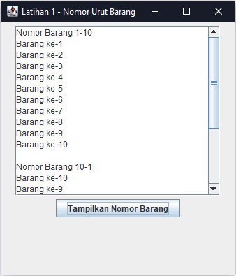
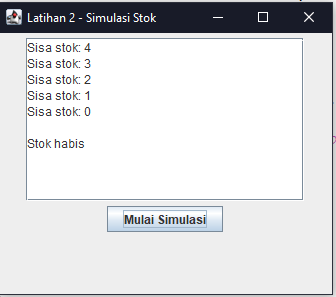
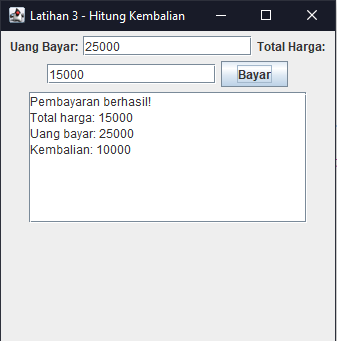
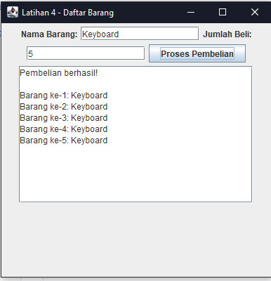

# Perulangan dan Penggunaan Method

## 👩‍🎓 Identitas Mahasiswa

- **Nama:** Zahran Naufal Amar
- **NIM:** C2483207012
- **Kelas:** PTI5A
- **Program Studi:** Pendidikan Teknologi Informasi
- **Perguruan Tinggi:** Universitas Muhammadiyah Tasikmalaya

## 📸 Latihan Mandiri

### 1. LatihanPertama nomor urut barang. Gunakan for untuk menampilkan “Barang ke-1” sampai “Barang ke-10”. Setelah berhasil, ubah program agar menampilkan nomor dari 10 turun ke 1.

.png)

### 2. LatihanKedua simulasi stok. Buat variabel stok awal bernilai 5. Gunakan while untuk mengurangi stok satu per satu sampai habis. Tampilkan sisa stok pada setiap pengulangan, lalu tampilkan pesan “Stok habis” setelah perulangan selesai.

### 3. LatihanKetiga method kembalian. Buat method hitungKembalian(int uangBayar, int totalHarga) yang mengembalikan hasil pengurangan uang bayar dengan total harga. Gunakan method tersebut pada cabang pembayaran berhasil dalam program praktik.

### 3. LatihanKeempat method daftar barang. Pindahkan perulangan penampil barang pada program praktik ke method tampilkanDaftarBarang(String namaBarang, int jumlahBeli) dengan tipe kembalian void. Panggil method tersebut setelah pembelian dinyatakan berhasil. Pastikan hasil program tetap sama.

